# Panele dla firm — przykładowe systemy branżowe

Jedenaście gotowych paneli do pokazania klientom: **przedszkole i żłobek**, **firma budowlana**, **firma ogrodzeniowa**, **salon fryzjerski**, **zakład pogrzebowy**, **kancelaria adwokacka**, **biuro rachunkowe**, **warsztat samochodowy**, **zarządca nieruchomości**, **serwis klimatyzacji i fotowoltaiki**, **pensjonat**.
Każdy działa w przeglądarce i na telefonie, bez instalacji i bez serwera, na wymyślonych danych.

**Strona demonstracyjna:** po włączeniu GitHub Pages adres będzie miał format `https://NAZWA_UZYTKOWNIKA.github.io/panele-dla-firm/`. Odnośniki w tabeli są przygotowane dla konta `dobrestronynl-hub`; zaczną działać po utworzeniu repozytorium i włączeniu GitHub Pages.

| Przedszkole i żłobek | Firma budowlana | Firma ogrodzeniowa |
|---|---|---|
| [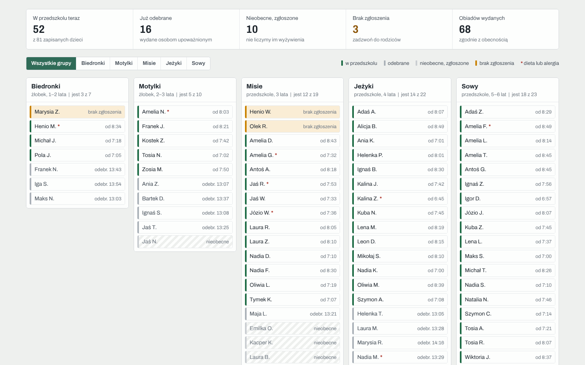](https://dobrestronynl-hub.github.io/panele-dla-firm/przedszkole/) | [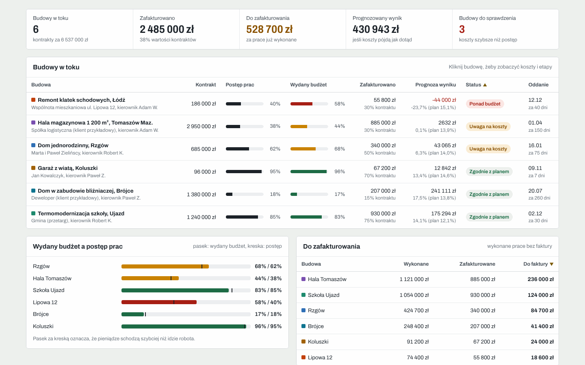](https://dobrestronynl-hub.github.io/panele-dla-firm/budowa/) | [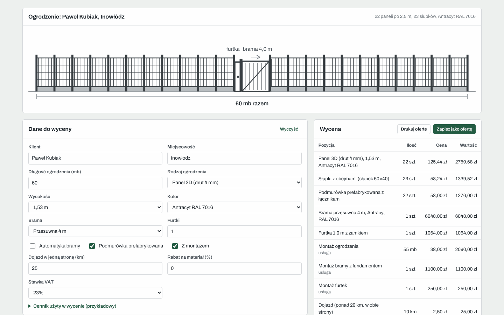](https://dobrestronynl-hub.github.io/panele-dla-firm/ogrodzenia/#kalkulator) |
| [Otwórz demo](https://dobrestronynl-hub.github.io/panele-dla-firm/przedszkole/) | [Otwórz demo](https://dobrestronynl-hub.github.io/panele-dla-firm/budowa/) | [Otwórz demo](https://dobrestronynl-hub.github.io/panele-dla-firm/ogrodzenia/) |

| Salon fryzjerski | Zakład pogrzebowy | Kancelaria adwokacka |
|---|---|---|
| [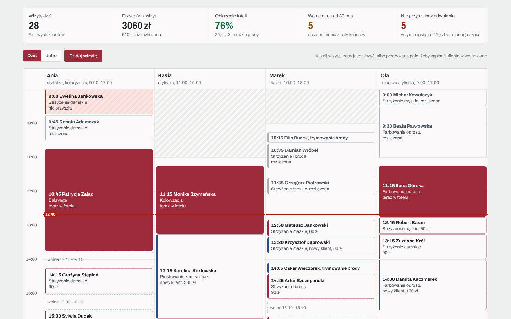](https://dobrestronynl-hub.github.io/panele-dla-firm/fryzjer/) | [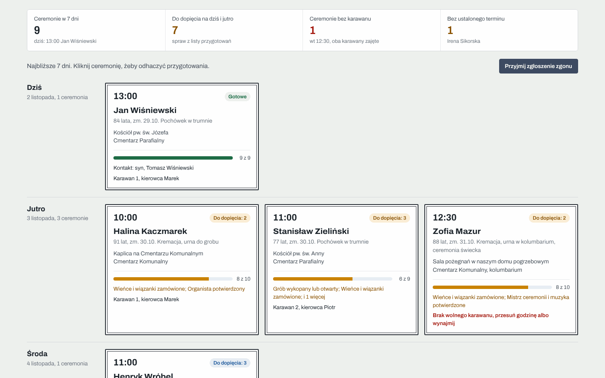](https://dobrestronynl-hub.github.io/panele-dla-firm/pogrzeb/) | [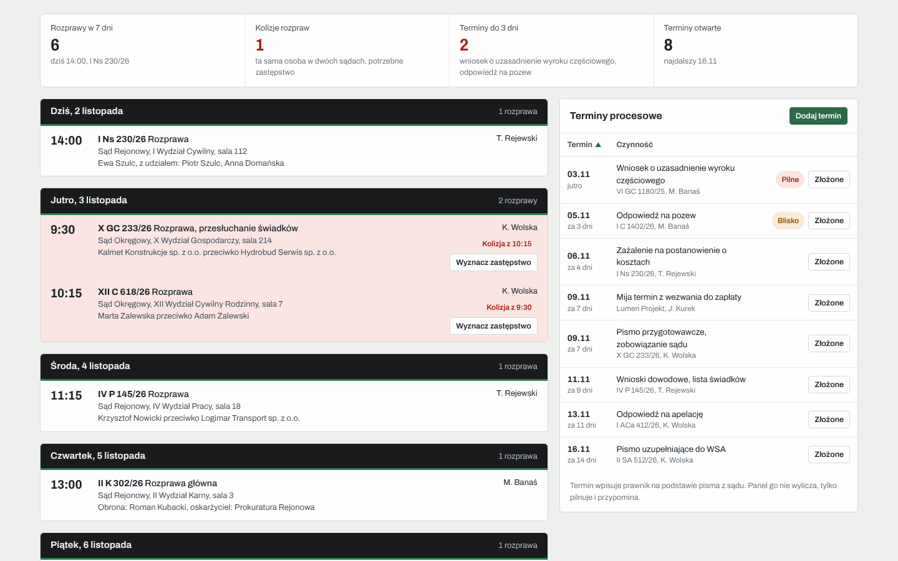](https://dobrestronynl-hub.github.io/panele-dla-firm/kancelaria/) |
| [Otwórz demo](https://dobrestronynl-hub.github.io/panele-dla-firm/fryzjer/) | [Otwórz demo](https://dobrestronynl-hub.github.io/panele-dla-firm/pogrzeb/) | [Otwórz demo](https://dobrestronynl-hub.github.io/panele-dla-firm/kancelaria/) |

| Biuro rachunkowe | Warsztat samochodowy | Zarządca nieruchomości |
|---|---|---|
| [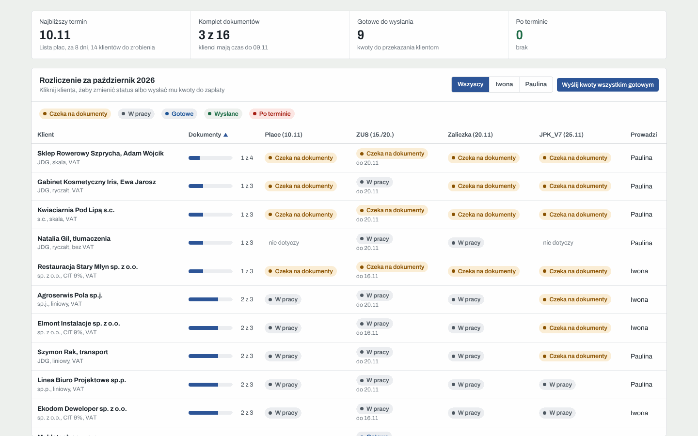](https://dobrestronynl-hub.github.io/panele-dla-firm/rachunkowe/) | [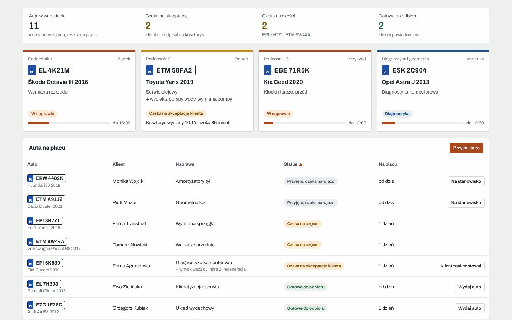](https://dobrestronynl-hub.github.io/panele-dla-firm/warsztat/) | [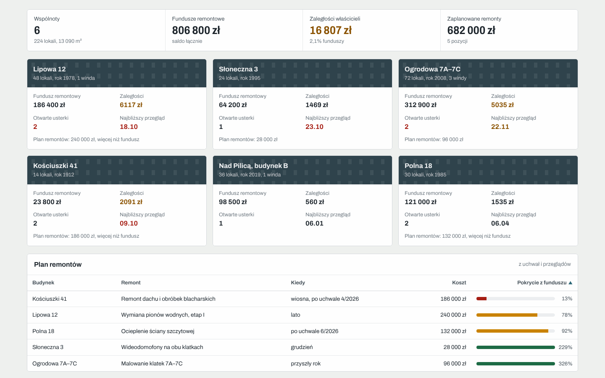](https://dobrestronynl-hub.github.io/panele-dla-firm/zarzadca/#budynki) |
| [Otwórz demo](https://dobrestronynl-hub.github.io/panele-dla-firm/rachunkowe/) | [Otwórz demo](https://dobrestronynl-hub.github.io/panele-dla-firm/warsztat/) | [Otwórz demo](https://dobrestronynl-hub.github.io/panele-dla-firm/zarzadca/) |

| Serwis klimatyzacji i PV | Pensjonat | |
|---|---|---|
| [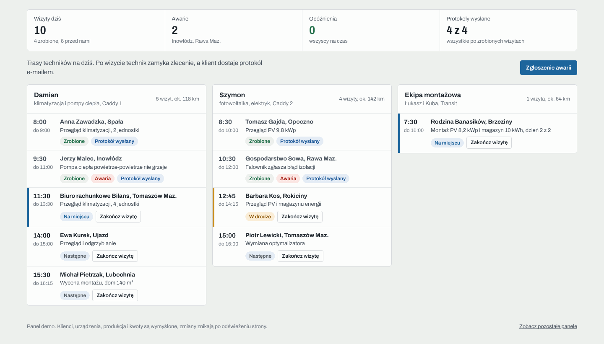](https://dobrestronynl-hub.github.io/panele-dla-firm/serwis/) | [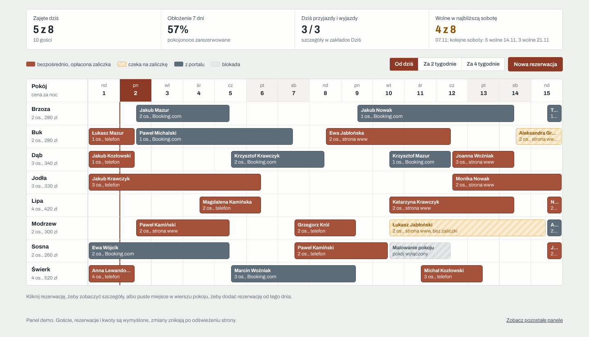](https://dobrestronynl-hub.github.io/panele-dla-firm/pensjonat/) | |
| [Otwórz demo](https://dobrestronynl-hub.github.io/panele-dla-firm/serwis/) | [Otwórz demo](https://dobrestronynl-hub.github.io/panele-dla-firm/pensjonat/) | |

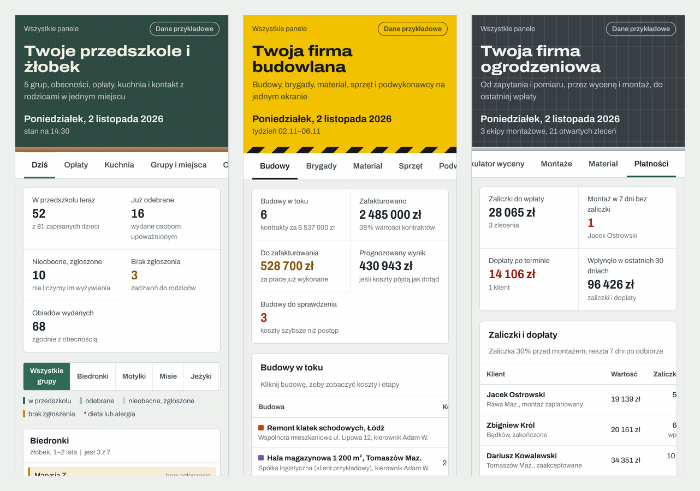

## Co jest w panelach

**Przedszkole i żłobek** (`przedszkole/`)
- Dziś: tablica obecności 5 grup, kto przyszedł, kto odebrał dziecko i kto może je odebrać
- Opłaty: czesne, wyżywienie liczone za dni obecności, godziny po 17:00, zaległości i przypomnienia
- Kuchnia: liczba posiłków na dziś według grup, diety i alergie, jadłospis na tydzień do druku
- Grupy i miejsca: limity, wolne miejsca, lista oczekujących z przyjmowaniem do grupy
- Ogłoszenia i zgody: kto przeczytał, kto nie podpisał zgody, nowe ogłoszenie

**Firma budowlana** (`budowa/`)
- Budowy: kontrakt, postęp prac, wydany budżet, prognoza wyniku, co można już zafakturować
- Brygady: plan tygodnia, przenoszenie brygad między budowami, koszt robocizny, nadgodziny
- Materiał: dostawy na budowy, opóźnienia, materiał w porównaniu z kosztorysem
- Sprzęt: gdzie jest każda maszyna, przeglądy i UDT, zwroty sprzętu z wynajmu
- Podwykonawcy i usterki: faktury, kaucje gwarancyjne i ich zwrot, usterki w gwarancji

**Firma ogrodzeniowa** (`ogrodzenia/`)
- Zapytania: lejek od zapytania przez pomiar i wycenę do montażu i zakończenia
- Kalkulator wyceny: panele, przęsła, sztachety, gabiony, bramy i furtki, rysunek ogrodzenia, oferta do druku (PDF)
- Montaże: kalendarz 3 ekip na 2 tygodnie, prognoza pogody, kolizje terminów
- Materiał: czy elementy wrócą z malarni przed montażem, stan placu
- Płatności: zaliczki przed montażem, dopłaty po odbiorze, przypomnienia

**Salon fryzjerski** (`fryzjer/`)
- Kalendarz: dzień 4 stanowisk, wolne okna do zapełnienia, rozliczenie wizyty z recepturą koloru, nieobecności bez odwołania
- Klienci: karta klienta z recepturą i historią, kto dawno nie był, zaproszenia SMS
- Usługi i cennik: ceny, czas, ile salon zarabia na godzinie fotela, przychód według usług
- Zespół i prowizje: wyniki każdej osoby, prowizje od usług i kosmetyków, obłożenie, grafik tygodnia
- Kosmetyki: stany, na ile tygodni wystarczy, zamówienie do hurtowni

**Zakład pogrzebowy** (`pogrzeb/`)
- Ceremonie: najbliższe 7 dni, lista przygotowań do każdej ceremonii, kolizje karawanów
- Sprawy i dokumenty: karta zgonu, akt zgonu, wniosek o kremację, upoważnienie do zasiłku, wniosek ZUS Z-12
- Chłodnia i transport: zajęte komory, przewozy, krematorium, dyżur przewozowy, przyjęcie zgłoszenia zgonu
- Kosztorys: pochówek w trumnie lub kremacja, wyliczenie zasiłku pogrzebowego (7000 zł) i dopłaty rodziny, wydruk
- Rozliczenia: wnioski w ZUS, wypłacone zasiłki, dopłaty rodzin po terminie

**Kancelaria adwokacka** (`kancelaria/`)
- Rozprawy i terminy: wokanda na najbliższe dni, kolizje rozpraw z wyznaczaniem zastępstwa, terminy procesowe wpisywane przez prawnika
- Sprawy: sygnatury, klient i druga strona, zespół, najbliższa czynność
- Czas pracy: stoper zaokrąglający do 6 minut, ręczne wpisy, godziny zespołu względem celu
- Rozliczenia: stawki godzinowe, ryczałty i ich stawka efektywna, budżet sprawy, wystawianie faktur, faktury po terminie
- Klienci i konflikt interesów: wyszukiwarka po klientach i stronach przeciwnych (także odmiany nazwisk), rejestr sprawdzeń

**Biuro rachunkowe** (`rachunkowe/`)
- Terminy miesiąca: tabela klient × obowiązek (płace, ZUS 15./20., zaliczka, JPK_V7) ze statusem, wysyłka kwot do zapłaty
- Dokumenty od klientów: czego brakuje, przypomnienia, kiedy klienci przysyłają dokumenty, KSeF
- Klienci i pakiety: abonament a liczba dokumentów, klienci ponad pakiet, propozycja nowego abonamentu
- Zespół: zaksięgowane dokumenty, otwarte rozliczenia, zastępstwa na urlopy
- Rozliczenia biura: faktury dla klientów, dopłaty ponad pakiet, zaległości

**Warsztat samochodowy** (`warsztat/`)
- Stanowiska: podnośniki i diagnostyka na dziś, auta na placu, wydanie auta, przyjęcie auta
- Zlecenia: kosztorys, dodatkowe naprawy czekające na akceptację klienta, SMS „auto gotowe”
- Części: dostawy na dziś i jutro, opóźnienia, marża, materiały poniżej minimum
- Opony i przypomnienia: przechowalnia opon, nieumówieni przed sezonem, płytki bieżnik, badania techniczne i wymiany oleju
- Wyniki: godziny sprzedane a przepracowane, wydajność mechaników, najczęstsze naprawy

**Zarządca nieruchomości** (`zarzadca/`)
- Zgłoszenia usterek: awarie, przypisanie fachowca, czas naprawy
- Budynki: fundusz remontowy, zaległości, najbliższy przegląd, plan remontów a pokrycie z funduszu
- Opłaty i zaległości: upomnienie, wezwanie przedsądowe, przekazanie zarządowi
- Przeglądy: roczne (gaz, kominy), pięcioletnie, windy (UDT), place zabaw
- Uchwały: głosowanie liczone udziałami, ile brakuje do większości, przypomnienia dla niegłosujących

**Serwis klimatyzacji i fotowoltaiki** (`serwis/`)
- Dziś w terenie: trasy techników, awarie, zamknięcie wizyty z protokołem dla klienta
- Przeglądy okresowe: terminy, SMS do klientów, gwarancje zagrożone brakiem przeglądu
- Instalacje PV: produkcja z ostatniego miesiąca w stosunku do oczekiwanej, falowniki offline
- Umowy i gwarancje: odnowienia umów serwisowych, kończące się gwarancje, urządzenia bez umowy
- Magazyn: stany i rezerwacje na zaplanowane montaże

**Pensjonat** (`pensjonat/`)
- Kalendarz pokoi: 8 pokoi na 2 tygodnie, rezerwacje bez zaliczki, blokady, nowa rezerwacja z kontrolą kolizji
- Dziś: przyjazdy, wyjazdy, sprzątanie pokoi
- Rezerwacje i zaliczki: zaliczki po terminie, przypomnienia
- Obłożenie i kanały: obłożenie, średnia cena za noc, ile zostaje po prowizji portalu
- Stali goście: kto wraca, oferty dla gości ze zgodą na e-maile

Każdą zakładkę można otworzyć bezpośrednim linkiem, np. `ogrodzenia/#kalkulator`, `pogrzeb/#kosztorys` albo `kancelaria/#konflikt`.

## Jak opublikować na GitHub Pages

1. Na swoim GitHubie utwórz **publiczne** repozytorium `panele-dla-firm` (GitHub Pages jest dostępne dla publicznych repozytoriów). Użyj swojego potwierdzonego konta `dobrestronynl-hub`.
2. Wrzuć pliki. Z wiersza poleceń, w folderze z tym plikiem:
   ```bash
   git init
   git add .
   git commit -m "Panele demo dla firm"
   git branch -M main
   git remote add origin https://github.com/dobrestronynl-hub/panele-dla-firm.git
   git push -u origin main
   ```
   Można też przeciągnąć wszystkie pliki i foldery w przeglądarce: **Add file → Upload files**.
3. W repozytorium wejdź w **Settings → Pages**. W sekcji **Build and deployment** wybierz **Source: Deploy from a branch**, gałąź **main**, folder **/ (root)** i kliknij **Save**.
4. Po zakończeniu wdrożenia strona będzie pod adresem `https://dobrestronynl-hub.github.io/panele-dla-firm/`.

Jeśli nazwiesz repozytorium inaczej, zmień adresy w tym pliku.

## Podgląd bez internetu

Otwórz `index.html` podwójnym kliknięciem. Wszystko działa lokalnie; bez internetu zamiast czcionki Archivo pokaże się zwykła czcionka systemowa.

## Jak dopasować do siebie

| Co | Gdzie |
|---|---|
| Nazwa firmy, adres WWW i wezwanie do działania | `index.html`, elementy nagłówka i stopki |
| Tytuł panelu („Twoja firma budowlana”) | `<h1>` na górze pliku panelu |
| Kolory tablicy i przycisków | zmienne `--sign-…` i `--accent…` w `<style>` na górze pliku panelu |
| Dane przykładowe (dzieci, budowy, zlecenia) | skrypt na dole pliku panelu, sekcja „Dane przykładowe” |
| Ceny w kalkulatorze ogrodzeń | `ogrodzenia/index.html`, sekcja „Cennik przykładowy” |
| Cennik zakładu pogrzebowego i kwota zasiłku | `pogrzeb/index.html`, sekcja „Cennik przykładowy” i stała `ZASILEK` |
| Usługi salonu, stawki prawników | `SERV` w `fryzjer/index.html`, `LAW` w `kancelaria/index.html` |
| Roboczogodzina i narzut na części | `RATE` i `MARGIN` w `warsztat/index.html` |
| Prowizje portali, zaliczka | `COMM` i `DEP` w `pensjonat/index.html` |
| Uzysk PV dla miesięcy | `YIELD` w `serwis/index.html` |
| Wspólny wygląd tabel, przycisków, okien | `assets/panel.css` |
| Wspólne funkcje (zakładki, tabele, daty, kwoty) | `assets/panel.js` |

## Pliki

```
index.html              strona startowa z jedenastoma panelami
przedszkole/index.html  panel przedszkola i żłobka
budowa/index.html       panel firmy budowlanej
ogrodzenia/index.html   panel firmy ogrodzeniowej
fryzjer/index.html      panel salonu fryzjerskiego
pogrzeb/index.html      panel zakładu pogrzebowego
kancelaria/index.html   panel kancelarii adwokackiej
rachunkowe/index.html   panel biura rachunkowego
warsztat/index.html     panel warsztatu samochodowego
zarzadca/index.html     panel zarządcy nieruchomości
serwis/index.html       panel serwisu klimatyzacji i fotowoltaiki
pensjonat/index.html    panel pensjonatu
assets/panel.css        wspólny wygląd
assets/panel.js         wspólne funkcje, bez zewnętrznych bibliotek
assets/screens/         zrzuty ekranu do strony startowej i tego opisu
.nojekyll               GitHub Pages podaje pliki bez przetwarzania
```

## Wykorzystanie w portfolio

- Każdy kafelek na stronie `index.html` prowadzi do konkretnej branży. Możesz osadzić zrzut ekranu i przycisk „Zobacz demo” na swojej stronie WWW.
- Nie przedstawiaj demonstracji jako gotowego systemu realizującego wysyłki, płatności, bezpieczne logowanie lub zarządzanie prawdziwymi danymi.
- Repozytorium może być publiczne, ale to nie oznacza automatycznie udzielenia innym licencji do ponownego użycia kodu.
- Gdy GitHub Pages zostanie uruchomione, możesz połączyć galerie branżowe ze stroną `https://dobrestrony.nl/`.

## Ważne

- Wszystkie osoby, firmy, kwoty i ceny są wymyślone. Zmiany w demo znikają po odświeżeniu strony, a daty zawsze liczą się od dzisiejszego dnia.
- To są makiety do pokazania klientom, nie gotowy system. Wersja dla klienta potrzebuje logowania, bazy danych i kopii zapasowych.
- Panel przedszkola w prawdziwej wersji przetwarza dane dzieci, w tym diety i alergie (dane o zdrowiu). Potrzebne są: logowanie z uprawnieniami, hosting w UE i umowa powierzenia przetwarzania danych.
- Panel kancelarii w prawdziwej wersji przechowuje informacje objęte tajemnicą adwokacką, a panel zakładu pogrzebowego dane zmarłych i ich rodzin. Oba wymagają logowania, szyfrowania i hostingu w UE.
- Kwota zasiłku pogrzebowego (7000 zł od 1 stycznia 2026) jest wpisana w jednym miejscu w `pogrzeb/index.html`. Przy zmianie przepisów wystarczy ją poprawić.
- Biuro rachunkowe: terminy w panelu to ZUS do 15. (podmioty z osobowością prawną) lub 20. dnia, zaliczki do 20. i JPK_V7 do 25., przesunięte z weekendu na poniedziałek. Przed wdrożeniem u klienta sprawdź je z aktualnymi przepisami.
- Panel kancelarii nie wylicza terminów procesowych. Wpisuje je prawnik, panel tylko przypomina. Sprawdzanie konfliktu interesów to podpowiedź z bazy, decyzję podejmuje adwokat.
- Licencja: bez pliku `LICENSE` kod jest objęty pełnymi prawami autorskimi (wszelkie prawa zastrzeżone). Jeśli chcesz pozwolić innym na użycie kodu, dodaj plik `LICENSE`.
- Czcionka Archivo pochodzi z Google Fonts i jest na licencji SIL Open Font License.
